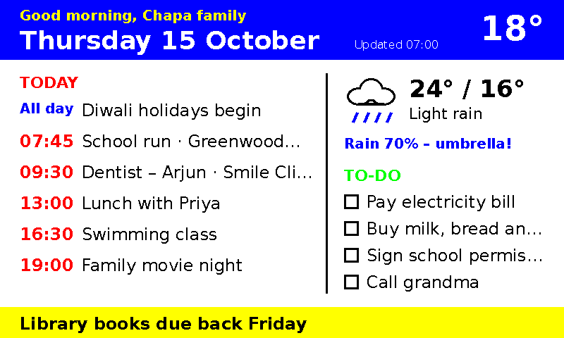

# edu-ai-made-easy: a physical Muse AI agent on e-ink

A family dashboard for the living room: your Meta **Muse** agent puts the morning briefing
(calendar, top to-dos, weather) on a **Seeed reTerminal E1002** 7.3" six-colour e-ink
screen every day at 7 am. It looks like paper, doesn't glow, and runs for months on its
battery.



## How it works

```
 ┌──────────┐ 1. 07:00 gather calendar/to-dos/weather       ┌────────────────────────┐
 │   Muse   │ ─── 2. POST /briefing (JSON, optional) ─────▶ │ muse-briefing server   │
 │  agent   │                                               │ (your LAN, port 8765)  │
 └────┬─────┘                                               │ renders 800×480 in the │
      │ 3. display.draw_url {"url": ".../briefing.rgb565"}  │ panel's exact 6 inks   │
      ▼                                                     └───────────▲────────────┘
 ┌───────────────────────────┐   4. HTTP GET /briefing.rgb565          │
 │ reTerminal E1002          │ ────────────────────────────────────────┘
 │ Muse Gadget SDK firmware  │   5. draws it (≈30 s refresh)
 └───────────────────────────┘
```

- **`firmware/`** builds and flashes the official
  [Muse Gadget SDK](https://github.com/facebookincubator/muse-gadget-sdk) for the E1002,
  pinned to a tested revision, with your SDK token injected at build time and never
  committed.
- **`briefing/`** (`muse-briefing`) renders the briefing and serves it to the device. Muse
  can push the data. Without a push, the server collects it from your ICS calendars, a
  to-do file and Open-Meteo.
- **`web-flasher/`** is a page for flashing the E1002 from Chrome, published to GitHub Pages.
- **`muse/SKILL.md`** is the skill you paste into Muse so it knows how and when to update
  the display.

### Why a server instead of letting Muse send any image?

The firmware Floyd–Steinberg dithers every image down to the panel's six inks (black, white,
yellow, red, blue, green). Anti-aliased text and soft colours come out as speckle. The
server draws with those six exact colours only, with no font smoothing, and sends raw RGB565.
Every pixel is already an ink, so the device's dither carries zero error and the panel
shows the picture pixel for pixel. A test (`briefing/tests/test_render.py`) runs the
firmware's own `nearest_ink()` logic to prove it.

## What you need

Full shopping list with prices and options: **[docs/shopping-list.md](docs/shopping-list.md)**.

| | |
|---|---|
| Seeed reTerminal E1002 | ~$99–109, [Seeed Studio](https://www.seeedstudio.com/reTerminal-E1002-p-6533.html) |
| USB-C **data** cable | charge-only cables show no serial port |
| A computer | macOS or Linux, for building and flashing. Can also run the server. |
| Always-on box on your Wi-Fi | for the server: a Raspberry Pi, NAS or that same computer |
| Muse account + app | iOS/Android, with Developer mode |
| Muse Gadgets SDK token | [gadgets.muse.ai/settings/sdk-tokens](https://gadgets.muse.ai/settings/sdk-tokens) |

## Setup (≈20 minutes plus the first ESP-IDF install)

### 1. Get an SDK token

Create one at <https://gadgets.muse.ai/settings/sdk-tokens> (it starts with `mgst_`) and
read the [Gadget SDK Terms](https://gadgets.muse.ai/sdk-terms). Tokens are personal and
non-commercial, cover at most 50 devices, and a device holding one must not be sold or
publicly listed.

### 2–3. Flash from Chrome: the easy way

Open the **web flasher**: <https://gutchapa.github.io/edu-ai-made-easy/> (Chrome or Edge on
a desktop computer).

1. Paste your SDK token. It stays in your browser and is sent to the device over USB after
   flashing. It is never part of the firmware file.
2. Plug in the reTerminal, click **Connect & install**, pick its port, and accept
   **Erase device** on the first install.
3. Close the installer when it's done. The page sends the token, and the reTerminal restarts
   ready to pair.

The page is built by `.github/workflows/web-flasher.yml`: tokenless firmware from the SDK
revision pinned in `firmware/sdk.lock`, compiled in the official `espressif/idf:v6.0.1`
container and deployed to GitHub Pages. Updates from the page keep the device's pairing,
Wi-Fi and token. To run it locally, download the `github-pages` artifact from a workflow
run, unpack it and serve it on `localhost` (Web Serial allows localhost without https).

**One-time repo setup:** GitHub → *Settings → Pages → Build and deployment → Source: GitHub Actions*, then re-run the `web-flasher` workflow. Until then the build runs but the deploy step fails.

Or build and flash it yourself, as below.

### 2. Build the firmware

```sh
firmware/setup-idf.sh          # once: ESP-IDF v6.0.1 + esp32s3 toolchain into ~/esp
firmware/fetch-sdk.sh          # Muse Gadget SDK at the pinned revision → firmware/.sdk
MUSE_SDK_TOKEN=mgst_... firmware/build.sh
```

`build.sh` also reads the token from `firmware/.sdk-token` (git-ignored) or asks for it.
The token goes only into the SDK's build directory.

### 3. Flash

```sh
firmware/flash.sh              # auto-detects the port; or: firmware/flash.sh /dev/ttyUSB0
```

If it can't connect: **hold BOOT, tap RESET, release BOOT**, and run it again. On Linux,
add yourself to `dialout` (Debian/Ubuntu) or `uucp` (Arch) if the port is
permission-denied.

### 4. Pair

1. Power on the reTerminal. The e-ink shows its pairing status.
2. Muse app → **Settings → Devices** → turn on **Developer mode**.
3. Pick the device named **`MuseGadget-Disp-XXXXXX`** and pair. Press **the green button**
   on top when asked to confirm.

### 5. Run the briefing server

On the always-on box:

```sh
cd briefing
python3 -m venv .venv && .venv/bin/pip install -e .
cp briefing.example.toml briefing.toml   # timezone, location, calendar ICS URLs
cp todo.example.md todo.md               # or point [todos] file at your own list
.venv/bin/muse-briefing serve
# → Device URL for display.draw_url: http://192.168.1.20:8765/briefing.rgb565
```

Open `http://<that-ip>:8765/` in a browser to preview exactly what the panel will show. To
keep it running, see [docs/run-as-a-service.md](docs/run-as-a-service.md).

### 6. Teach Muse

Copy [`muse/SKILL.md`](muse/SKILL.md) into your Muse chat, with `BRIEFING_URL` replaced by
the device URL from step 5. Then say:

> Every morning at 7 am, generate our family briefing (calendar, top to-dos, weather) and
> show it on the living-room display.

## Testing without the hardware

No reTerminal yet? `muse-briefing simulate` shows what the panel would display for any image
or URL. `muse-briefing emulate` runs a virtual reTerminal with a live browser view. A patched
Linux gadget lets a **real Muse** drive that virtual panel end to end. All three use the
firmware's own image and dither logic, cross-checked against the compiled C. See
**[docs/simulator.md](docs/simulator.md)**, including the colour byte-order bug in the
pinned firmware that the simulator found.

## `muse-briefing` commands

| Command | What it does |
|---|---|
| `muse-briefing demo --out out` | Render the built-in sample. No network or config. |
| `muse-briefing render -c briefing.toml --out out` | Collect from your sources and write `briefing.png` + `briefing.rgb565`. |
| `muse-briefing render --json today.json --out out` | Render a briefing JSON (the same shape Muse posts). |
| `muse-briefing serve -c briefing.toml` | Run the HTTP server. |
| `muse-briefing simulate out/briefing.rgb565 --out panel.png [--fixed]` | What the reTerminal would show for an image file or URL. |
| `muse-briefing emulate [--fixed]` | Virtual reTerminal with a live view at http://127.0.0.1:8766/. |
| `muse-briefing decode out/briefing.rgb565 check.png` | Turn raw RGB565 back into a PNG, to inspect what the device receives. |

### HTTP API

| Method & path | |
|---|---|
| `GET /briefing.rgb565` | 768,000 bytes of RGB565, high byte first. This is the URL for `display.draw_url`. |
| `GET /briefing.png` | The same picture as PNG. Add `?refresh=1` to re-collect now. |
| `GET /briefing.json` | The data behind it and whether it was `pushed` or came from `sources`. |
| `POST /briefing` | Push today's briefing (schema in `muse/SKILL.md`). Needs `Authorization: Bearer <push_token>` if one is set. |
| `DELETE /briefing` | Drop the pushed briefing and go back to the built-in sources. |

A pushed briefing is used only on its own `day`. Collected data is cached for
`cache_minutes`.

## Development

```sh
cd briefing && python3 -m venv .venv && .venv/bin/pip install -e '.[test]'
.venv/bin/pytest -q
```

CI runs the tests on Python 3.11 and 3.13, uploads a rendered preview, and shellchecks
`firmware/`.

## Troubleshooting

| Symptom | Fix |
|---|---|
| `draw_url` → `could not connect` | The device can't reach the server. Use the LAN IP (not `localhost`), check the firewall on port 8765, and keep the device and server on the same Wi-Fi. |
| `draw_url` → `out_of_memory` | Use `http://`, not `https://`. Retry once after a minute. |
| Colours look speckled | You sent a JPEG or PNG. Use `/briefing.rgb565`. |
| Panel flashes for ~30 s | Normal for Spectra 6 refreshes. |
| Calendar empty | Open `/briefing.json` and check the server log. The ICS URL must be the *secret* iCal address. |
| Wrong day after midnight | Set `[general] timezone`. |

## Credits & licence

Based on the *Physical AI Agent Setup Guide* (built on @nicbstme's project) and the Muse
Gadgets SDK (Apache-2.0, © Meta Platforms). This repo is Apache-2.0. Not affiliated with
Meta or Seeed. Follow the official docs and SDK terms.
